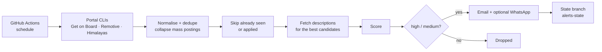

# Job Alerts Engine

[](https://github.com/ZarRubio/job-alerts-engine/actions/workflows/ci.yml)
-brightgreen)


A personal job-alert pipeline that searches job boards twice a day, scores every new posting against a candidate profile and emails only the ones worth applying to, with a one-line summary of what each job is about and which parts of its stack the candidate already has.

I built it for my own search (full stack + applied AI roles in Lima, Peru, and remote LATAM) and **measured it against 226 real postings I labelled by hand**:

| Metric (alert = fit high or medium) | Keyword baseline | Current model |
|---|---|---|
| Precision | 61.5% | **86.0%** |
| Recall | 87.9% | **94.8%** |
| F1 | 0.72 | **0.90** |
| Precision of "high" alerts | 82.6% | **100%** |

> Honest caveat: the model was tuned on the same 226 postings it is scored on, so these numbers are optimistic. A hold-out evaluation on postings collected after tuning is the next step. The labelled corpus is not published because it contains third-party job descriptions; the evaluation tool and a small synthetic sample are.

## How it works



The score is deterministic (no LLM, no API cost) and every point is explained in the email:

- **Role, from the title.** Role categories (AI/LLM, full stack, analyst-developer, ERP, automation…) are grouped, so a title naming three of them counts once. Seniority, non-development tracks (QA, security, sales, product) and off-stack titles (COBOL, Go, React Native…) subtract.
- **Stack coverage, from the description.** ~100 technologies are classified as *have* (1), *partial* (0.5: declared, academic or learning) or *missing* (0). Coverage above or below a pivot adds or subtracts points, so a posting full of tools the candidate lacks sinks even with a good title.
- **Hard gates.** Relocation, another city without full remote (a Lima district beats a mislabelled region), a foreign-only location, another required language, or a gig-platform employer exclude the posting. Years of experience above a threshold subtract.
- **Special tracks.** BI / data-analyst postings alert only when they also ask for Python, automation or AI, and never above "medium", so they cannot crowd out development roles.

### Example alert (synthetic postings)

```text
[ALTA 100] Software Engineer - Agentic AI — Agents Lab (Remote · LATAM)
  https://example.com/jobs/s12  (vía Remotive)
  De qué trata: you will ship LLM agents with tool calling, evaluation sets and Python. Claude Code in daily use. Remote, LATAM time zones.
  Pide: ✓ Python, LLM, Agentes de IA · híbrido/remoto
  Motivos: rol de desarrollo; menciona Claude Code; IA/LLM (tu meta de carrera); stack 100% cubierto; híbrido/remoto (prioridad)

[MEDIA 74] Analista de Datos e IA — Banco Ejemplo (Lima, Peru)
  De qué trata: modelos de datos en SQL y Power BI, automatización con Python y prototipos de IA generativa. Modalidad híbrida.
  Pide: ✓ Python, SQL, Power BI · híbrido/remoto
  Motivos: ...; BI con Python/automatización/IA (máx. medio)
```

The alert text is in Spanish because the candidate searches in Peru; the code, config keys and docs are in English.

## Repository layout

| Path | What it is |
|---|---|
| `tools/job_alerts.py` | CLI: `--dry-run`, `--no-notify`, `--test-notify`, `--collect` |
| `tools/alerting/` | `search.py` (portal CLIs, dedupe, details), `scoring.py` (the model), `notify.py` (email/WhatsApp, secret redaction), `state.py`, `common.py` |
| `tools/eval_alerts.py` | Precision, recall, F1 and the misclassified postings for a labelled corpus |
| `job_scraper/alert_config.json` | Queries, portals and every scoring rule. Tuning is a config change, not a code change |
| `portals/*/cli` | TypeScript/Bun CLIs for Get on Board, Remotive and Himalayas: `search`/`detail`, JSON output, backoff on 429/5xx, zero runtime dependencies, network-free tests |
| `examples/sample_corpus.jsonl` | 12 synthetic labelled postings to try the evaluator |
| `.github/workflows/` | `ci.yml` (tests, ruff, mypy, portal tests) and `job-alerts.yml` (the scheduled run) |

## Run it

Requirements: Python 3.10+ (no runtime dependencies) and [Bun](https://bun.sh) for the portal CLIs.

```bash
git clone https://github.com/ZarRubio/job-alerts-engine && cd job-alerts-engine
pip install -e ".[dev]"                                   # installs the job-alerts and job-alerts-eval commands
for d in portals/*/cli; do (cd "$d" && bun install); done

job-alerts --dry-run --max-details 5                      # search and score, print, send nothing
job-alerts-eval --corpus examples/sample_corpus.jsonl --errors
```

Config, state and portals are read from the repository checkout. To keep your own config and state elsewhere, point `JOB_ALERTS_HOME` at a folder with the same `job_scraper/` and `portals/` layout.

To get emails, set `ALERT_SMTP_USER`, `ALERT_SMTP_APP_PASSWORD` (a Gmail app password) and `ALERT_EMAIL_TO`, then run without `--dry-run`. In GitHub Actions they are repository secrets; the workflow keeps the "already alerted" state on an orphan `alerts-state` branch so nothing personal lands on `main`.

### Measuring a change

```bash
python tools/job_alerts.py --collect job_scraper/eval/corpus.jsonl --max-details 60  # append new postings, label: null
# label them (1 = worth an alert, 0 = not; "unsure": true for borderline cases)
python tools/eval_alerts.py --errors      # before and after editing alert_config.json
```

`tests/test_eval_alerts.py` enforces minimum precision, recall and F1 on the labelled corpus when it is present, so a tuning change that degrades the model fails CI.

## Design decisions

- **Deterministic first, not an LLM.** The filter runs twice a day over a few hundred postings. Rules cost nothing, run in seconds, never hallucinate a requirement and explain every point they give. An LLM re-ranking of the top results is a possible next layer, and it would have to beat the same labelled corpus to earn its cost.
- **Measured, not eyeballed.** Every tuning change is judged by precision, recall and F1 on hand-labelled real postings, and CI enforces minimum values so a regression cannot slip in unnoticed.
- **Tuning is configuration.** Every pattern, weight and threshold lives in `alert_config.json`; the code only interprets it. Adapting the engine to another profile means editing JSON, not Python.
- **Explainability over a single number.** The email shows why a posting scored what it did and which parts of its stack are covered, so the reader can disagree with the model in seconds.
- **Secrets and personal state stay out of git.** Credentials come from environment variables and are redacted from every log and message; the alert history lives on a separate orphan branch.

## Quality

- 51 Python tests (scoring cases, dedupe, notifications with mocked SMTP/HTTP and secret redaction, CLI runs with mocked portals, the evaluator) plus Bun tests for each portal CLI. Coverage of the engine is ~87%, with an 85% gate in CI.
- `ruff` (lint + format) and `mypy` in CI; actions pinned to commit SHAs; checkout without persisted credentials; Dependabot for Actions, npm and pip.
- Versioned releases with a [changelog](CHANGELOG.md).

## How it was built

I designed it and directed the implementation with **Claude Code** (multi-agent: subagents with self-review loops), reviewing every change. The dedupe and state helpers (`tools/job_key.py`, `tools/rank_state.py`, `tools/scrape_state.py`) come from the open-source [ai-job-search](https://github.com/MadsLorentzen/ai-job-search) framework by Mads Lorentzen (MIT); the alert pipeline, scoring model, evaluation and the three portal CLIs are my additions.

## License

MIT, see [LICENSE](LICENSE).
